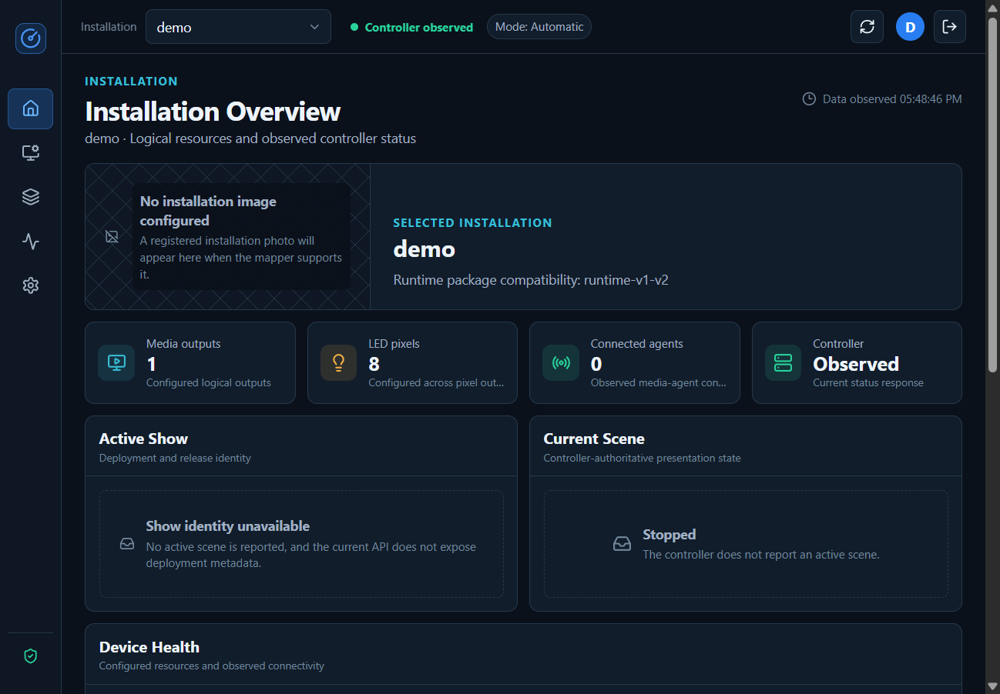
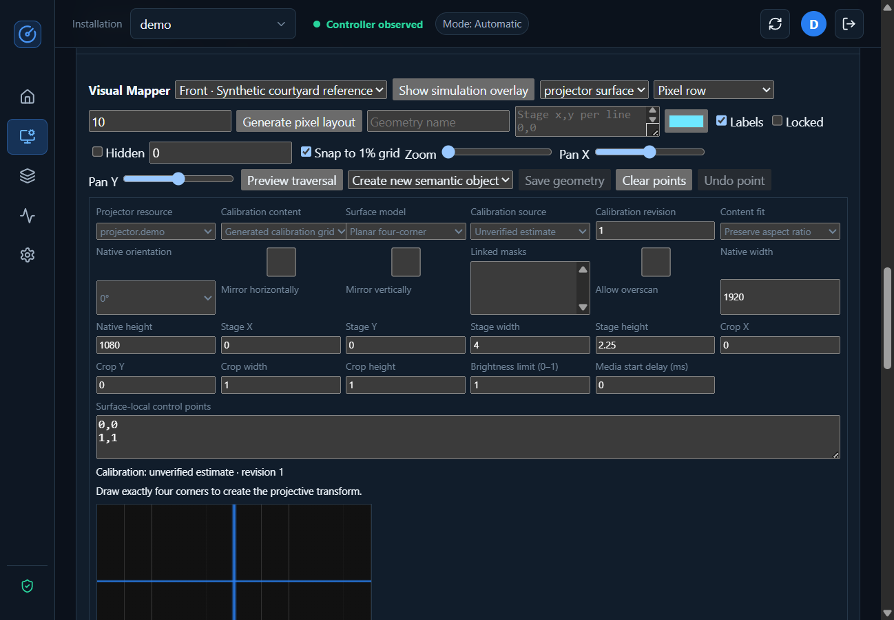
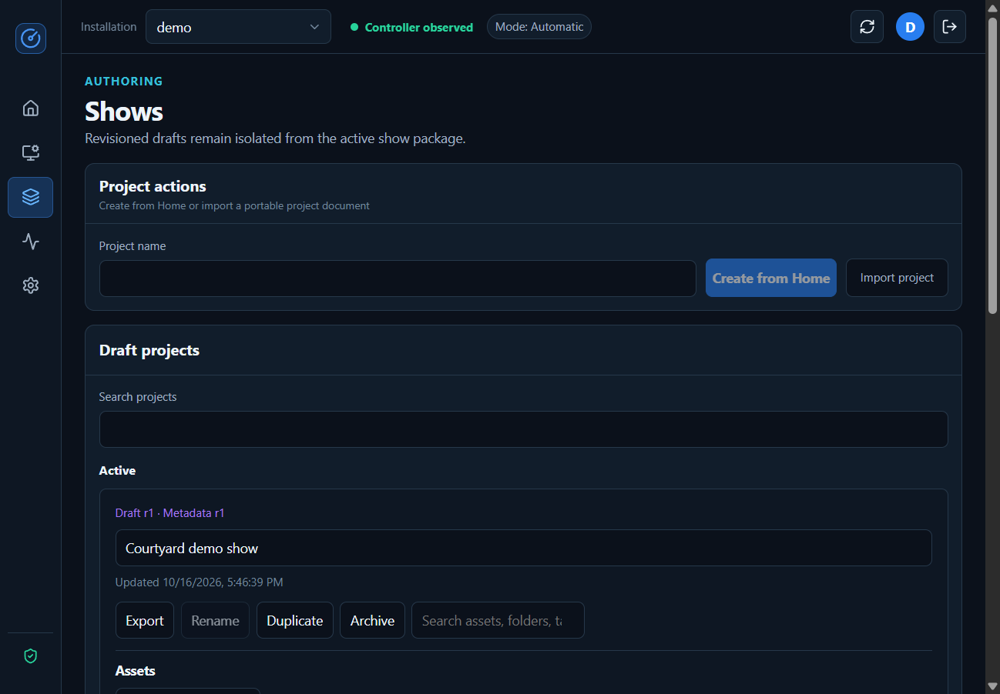
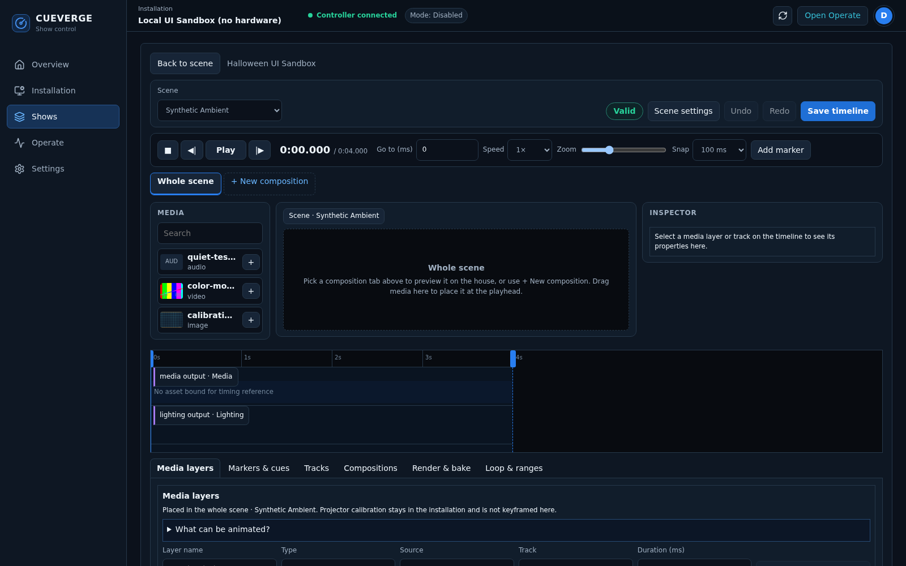
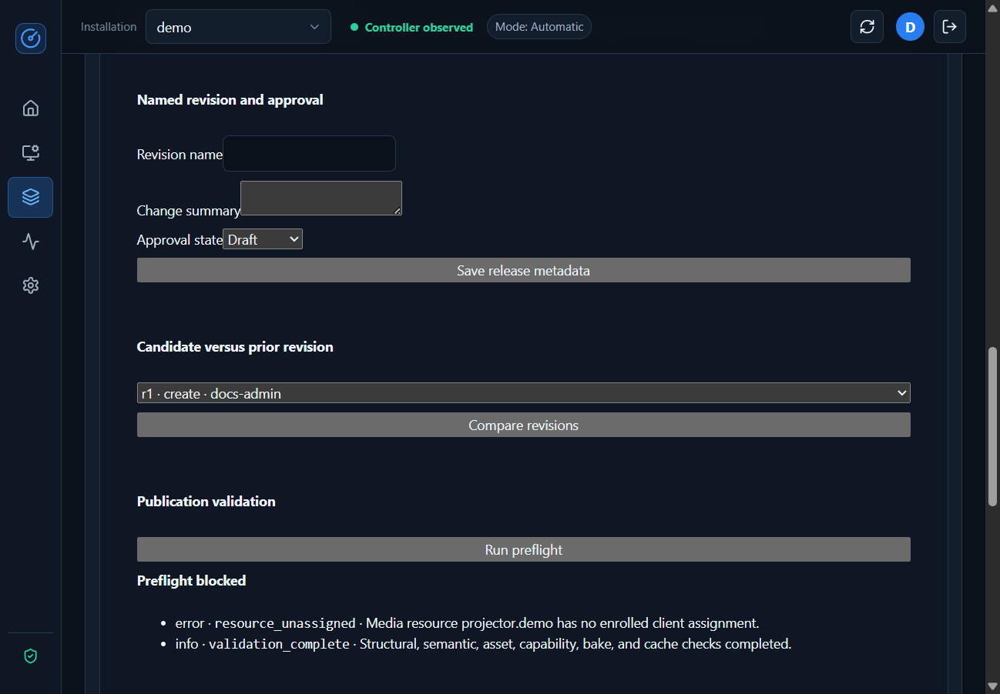
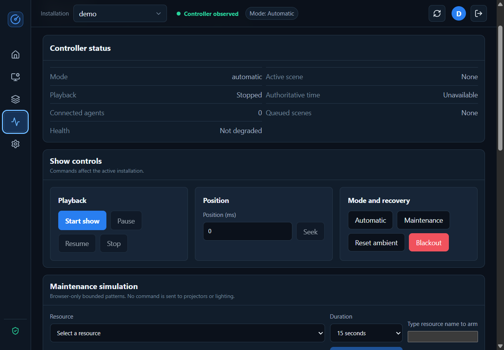

# Installation and show operator guide

This guide follows the operator's workflow: prepare an installation, create a
show, rehearse it, release it, and run it safely. For host setup, networking,
accounts, backups, and upgrades, use the
[service administration guide](service-administration.md).

It documents the current application, not a promise that every roadmap item
is available. Read the [current boundaries](#current-boundaries) before
planning a live opening.

## Contents

- [Orientation and safety](#orientation-and-safety)
- [Creating an installation](#creating-an-installation)
- [Creating and organizing a show](#creating-and-organizing-a-show)
- [Authoring scenes and timelines](#authoring-scenes-and-timelines)
- [Authoring autonomous behavior](#authoring-autonomous-behavior)
- [Previewing and rehearsing](#previewing-and-rehearsing)
- [Publishing and handing over](#publishing-and-handing-over)
- [Running a show](#running-a-show)
- [Current boundaries](#current-boundaries)

## Orientation and safety

### The objects you work with

| Object | Meaning |
| --- | --- |
| Installation | Physical resources and their mapping: projectors, lighting, geometry, viewpoints, assignments, and calibration |
| Logical resource | Stable show-facing name, such as `projector.demo`; not an IP address or a device credential |
| Project | Revisioned working show, assets, editor metadata, comments, and access permissions |
| Scene | A media-synchronized unit with duration, resources, lighting, interruption, and completion behavior |
| Composition | Reusable time-based content in projector-native, lighting-surface, or shared-stage coordinates |
| Revision | Persisted version of a project; the basis for review, render, and publication |
| Published package | Immutable release snapshot; publication, staging, activation, and playback are different steps |

Editing a draft does not edit the active runtime package. Browser preview
time is not venue playback time. During actual playback, lighting follows the
designated media output's reported clock.

### Navigation

*All screenshots in these guides were captured with the integrated browser
against an isolated controller using synthetic demo data. No live hardware
was connected. Empty, disconnected, and blocked states are intentional.*

- **Overview:** configured resource counts, observed connectivity, current
  scene, activity, and available installation information.
- **Installation:** topology, photos, mapper, device management, assignments,
  and connection diagnostics.
- **Shows:** projects, assets, collaboration, scene presets, timeline, show
  logic, rehearsal, and publication.
- **Operate:** live transport, operating mode, maintenance simulation,
  per-output status, and runtime diagnostics.
- **Settings:** administrator-managed local users and installation records.

Use **Refresh status** before making a decision based on connectivity or mode.
Status displays include observation times; they are not proof of a continuously
live feed. **Open Operate** provides access to transport and blackout; the
current application does not provide a global emergency-stop control on every
editor screen.

### Before any physical output

- Confirm who has authority to operate and who can invoke the site's physical
  safe-stop procedure.
- Verify the exact installation, resource assignments, show revision, and
  operator permissions.
- Inspect projector aim, audience access, pixel wiring/power, brightness, audio
  level, and any installation-specific hazards.
- Keep a physical safety procedure independent of the browser and network.
  Software blackout is not an electrical interlock.
- Do not use a browser grid, simulation result, or green controller badge as
  evidence that a speaker, projector, or real pixel has been checked.

## Creating an installation

### 1. Establish the running installation

An administrator first deploys the controller with a validated runtime package
and enables the necessary adapters. The active installation is derived from
that package. On a fresh synthetic deployment it is named `demo`; older
screens and the **Create from Home** button use "Home" for this runtime-backed
installation.

To create an additional planning record:

1. Open **Settings > Installations** as administrator.
2. Enter **New installation name**, then choose **Create installation**.
3. Set its folder, comma-separated tags, and favorite state as needed; save.

**Expected result:** a durable record marked **Not provisioned**. It cannot
be selected as a running installation in the header. This action does not
attach a package, change the active installation, or deploy another controller.
There is no end-to-end GUI provisioning wizard for that handover yet; involve
the technical operator before planning live output from the new record.

The runtime-backed record cannot be deleted. Do not delete a record that
another project or installation artifact still uses.

### 2. Verify resources and devices

Open **Installation** and compare **Installation Package** with the physical
inventory. Record resource names, media hosts, native output sizes, lighting
pixel counts, segment ranges, fixtures, paths, and intended clock source.

An administrator enrolls devices, reviews capabilities, and assigns identities
to logical resources. Discovery never grants trust. Assignments must be
changed with playback idle and the device disconnected; follow
[device enrollment](service-administration.md#enrolling-and-maintaining-media-hosts).
Controller-owned DDP destinations remain private deployment configuration,
not photo geometry.

**Expected result:** the correct enrolled devices and resources appear in
topology, with fresh connection/capability information. Independently check
video, audio, and pixels; "not independently detectable" is not a fault to
hide or a health check to waive.

### 3. Add reference photos

1. Open **Installation > Installation Photos**.
2. Enter a descriptive **Photo name** and **Named viewpoint**, such as
   "Wide front view" and "Audience center".
3. Choose **Add installation photo** and upload a JPEG, PNG, or WebP that
   you own or have permission to use.
4. Check the orientation, crop, and optional scale hint; choose **Save photo**
   after adjustments.
5. Add useful alternate angles or close-ups, within the 12-photo budget.

Use non-sensitive photos where practical. Photos describe viewpoints, not
separate physical outputs. The Visual Mapper becomes available after a photo
has been uploaded.

### 4. Map geometry and outputs

*The capture shows mapper inputs before calibration, not a calibrated venue.
The reference uploaded for this walkthrough was a generated courtyard diagram.*

1. Select the named viewpoint and geometry kind in **Visual Mapper**.
2. Name the geometry and place points on the reference view. Choose the
   appropriate kind: output, pixel segment, fixture, path, projector surface,
   mask, audience zone, or safety zone.
3. Use grid snapping, zoom/pan, color, labels, ordering, and locked/hidden
   states to keep the map legible. Save geometry after placing valid points.
4. When the same real object appears in another view, use **Link geometry
   across viewpoints** rather than inventing a second semantic object.
5. Keep photo coordinates, physical/shared-stage coordinates, native
   projector pixels, and lighting-local coordinates distinct.

For a planar projector surface:

- Select its **Projector resource** and actual native width/height.
- Draw exactly four corners in consistent perimeter order.
- Set stage placement/size, orientation, mirroring, crop, fit, linked masks,
  and brightness limit deliberately.
- Record the calibration source and revision. An **Unverified estimate**
  is not a measured calibration.
- Use native and installation warp previews to inspect the transform. Use
  subdivided surfaces only when the physical shape requires a validated mesh.

For lighting:

- Select **pixel segment** under **Geometry type** in the properties inspector.
  Give it a **Geometry name** and choose its configured **Output resource**.
- Use **Trace on photo** for existing strands: click the first pixel's location,
  then trace the strand in wiring order. Two points define a straight section;
  additional points define bends. Use **Undo point**, **Clear points**, and
  **Fit view** in the drawing toolbar without clearing the segment's properties.
- Enter **First pixel index** (zero-based), **Pixel count**, and an optional
  **Strand ID**. The allocation summary displays the inclusive first and last
  indices. Out-of-range allocations cannot be saved; overlaps on the same output
  are warnings, excluding linked views of the same semantic object.
- Alternatively, choose **Generate layout** for a row, grid, ring, outline,
  individual pixel, or imported coordinates. It uses the same **Pixel count**;
  grids and imports calculate their count. Generating replaces the current drawing.
- Use **Appearance** for labels/color/layering, **Grouping & associations** for
  fixture/group/path IDs and cross-view linking, **Shared stage coordinates**
  for shared points, and **Advanced calibration** for local dimensions, pixel
  corrections, stage transforms, brightness, and timing.
- Choose **Wiring direction**, then **Save segment** (or **Update geometry**
  when editing). **Preview traversal** uses saved mappings for the selected
  output, not unsaved edits or just the selected segment. A five-pixel pulse
  travels through increasing output indices across the entire device. Each
  segment has a distinct color and a numbered legend showing its index range
  and direction. Linked photo views count as one segment; segments on another
  photo are identified in the legend and progress readout.
- Pause, change the speed, or scrub **Output pixel index** to inspect segment
  boundaries and the first/last pixels. Restart returns to index zero and pauses.
  Unmapped indices remain gaps in the sequence rather than being skipped.
  Overlaps and invalid ranges are reported explicitly. Reduced-motion
  preferences start the preview paused. These controls are browser-only and
  do not send hardware commands or certify physical wiring.
- Pixel segment ranges use half-open intervals: `[start, end)` includes
  `start` but excludes `end`. An eight-pixel output has indices 0 through 7.
- **Maintenance preview** records an index-chase simulation for the selected
  output and duration. It requires maintenance mode and idle playback but does
  not drive physical LEDs. Verify actual wiring in a separate authorized physical
  test. Drawing a path does not change wiring order.

To check the real output from Cueverge, open **Test this output on physical
LEDs** inside the traversal preview, or use **Operate > Physical LED output
tests**. This is separate from the simulation-only maintenance preview:

1. Stop playback and enter **Maintenance**.
2. Choose a configured LED output, duration (5, 15, or 30 seconds), and chase
   speed. The output must have an enabled DDP driver whose expected pixel count
   matches the running installation.
3. Leave **Use saved segment colors** checked to match the preview's segment
   colors and boundaries. Linked photo views count once. Save complete mappings
   and resolve conflicting ranges first. For an unsegmented white index chase,
   uncheck this option. Unmapped indices also use white.
4. Type the exact output resource name into **Confirm physical output name**
   and choose **Start physical chase**. This sends real output, not a simulation.
   Within the mapper, the preview follows the controller's reported pixel
   position, sampled once per second.
5. Observe the pulse through the complete output and compare the physical
   segment boundaries/directions with the photo. Choose **Stop physical chase**
   when finished. Otherwise the controller stops at the deadline, even if the
   browser closes.

The test uses existing output-driver brightness settings without an extra
test-specific brightness cap. It targets 60 frames/second with fractional-pixel
crossfading for smooth motion, without changing the show's configured render rate.
Network loss or device refresh limits can still cause stuttering.
Downstream devices and power supplies are assumed
to be correctly configured. Only one physical test runs at a time, and show
playback is blocked while it owns the output. Stop/disarm, mode changes, global
Stop, and controller shutdown terminate the test. Completion sends a black frame
to the tested output and releases realtime output; subsequent preset/timeout
behavior remains controlled by the downstream device. Transmission errors are
reported, but successful UDP sending is not proof that the LEDs visibly responded.
Testing does not publish, alter mappings, or reload the show.

For shared-stage content across projectors, define stage coverage and overlap
calibration consistently. Review seams, masks, crop, brightness/color matching,
and mapped/native previews. Correct mapper diagnostics before rendering or
publication; do not use distorted content as a substitute for calibration.

### 5. Establish timing and acceptance

Where the assigned device advertises timing-calibration support, use its
declared ranges, resolution, and safe-test procedure. Compare baseline and
proposed settings, record the test asset/version, observed variability,
hardware/routing/display mode, and notes, then accept or cancel the session.
Re-review calibration after changing hardware, cabling, display mode, routing,
or media settings.

Accepted calibration records and browser previews are not proof of a physical
timing measurement. The current maintenance patterns are simulation-only.
Have the technical operator perform the required physical reference test.
Controller lighting delay and agent audio delay are separate deployment
settings; positive audio delay delays audio, and positive lighting delay delays
lighting. Do not guess compensation from the time a command was clicked.

**Installation acceptance:** correct resource identities, measured geometry and
pixel order, usable video/audio, deliberate safe output states, reconnect
behavior, and recorded physical timing checks.

## Creating and organizing a show

### 1. Create an isolated project

1. Open **Shows** with authoring permission.
2. Enter **Project name** and choose **Create from Home**.
3. Verify the new draft revision and inherited scenes/resources.

The button copies the controller's current runtime catalog; it does not
create an empty show or use the unprovisioned record you just created in
Settings. Alternatively, use **Import project** with a compatible Cueverge
project JSON document.

Use **Rename**, **Duplicate**, **Archive**, project search, and **Export** to
organize work. Export is a portable project document, not a backup of original
media, device credentials, or the complete controller service. Keep those
separately.

### 2. Arrange collaboration

Ask an administrator to add team members under **Collaboration > Project
access**. A person needs an account and project membership. Use comments and
change requests for review; associate an object ID when feedback concerns a
specific scene or object.

Designers edit; publishers approve/release; operators need live-output
authorization to run the installation. A publisher also needs **Permit live
output** for package activation, deactivation, and rollback.

Concurrent edits are revision checked. If a save reports a conflict, preserve
your intended changes, reload the latest draft, compare, and reapply them
deliberately. Do not repeatedly submit an obsolete revision.

### 3. Import and review assets

1. In the project **Assets** area choose **Add visual or audio asset**.
2. Wait for upload verification and processing, not just completion of the
   browser progress indicator.
3. Review the asset state, metadata, original availability, thumbnails,
   proxies, waveforms, and any processing/scanner diagnostics.
4. Set useful names, folder/tags/favorite state, ownership, license,
   provenance, review state, and expiry where appropriate.
5. Place a ready asset into the intended scene/output or composition.

Managed formats include MP4/QuickTime/WebM video, FLAC/MP3/Ogg/WAV audio,
and JPEG/PNG/WebP images. A format name alone does not guarantee the codec or
profile works on a target device. A scan marked `unavailable` is not a
clean scan. Failed, quarantined, missing, or incomplete assets must be resolved
before release.

Review proxies are editorial aids. Preserve the originals and verify the
actual render/playback output. Package-relative media used outside the managed
artifact workflow must also exist beneath the media agent's private asset
root; importing a project JSON file does not copy those files.

### 4. Optionally author through chat

Open the project's **MCP-assisted authoring** workspace and create a named
client token. Copy the secret once and connect the chat client to `/mcp/` on
the controller's HTTPS origin using bearer authentication. Keep the token
private; it is bound to your user and this project.

Choose only the permissions the client needs:

- **Create isolated draft proposals** keeps the existing human
  validation/approval/merge workflow.
- **Edit working drafts directly** lets chat save changes immediately as a new
  revision, without a proposal or GUI confirmation. The client should read the
  draft and revision first, then save the complete edited draft against that
  revision. Conflicts require rereading and reconciling, not overwriting.
- **Approve releases, publish, and stage packages** allows the client to approve
  release metadata and publish/stage a validated revision.
- **Activate staged packages** is separate and can affect physical output.
  It requires publisher access plus a live-output grant, or global administrator
  access. Keep it disabled unless the client is trusted to deploy output.

The new permissions are unchecked by default; existing tokens do not gain them.
Direct edits do not implicitly publish or activate. Publishing and activation
still follow the checks and handover boundary in
[Publishing and handing over](#publishing-and-handing-over): artifact activation
does not replace the running controller scene catalog or start a scene.
The proposal path remains available, although direct edits can make pending
proposals stale. See [MCP-assisted authoring](operations.md#mcp-assisted-authoring)
for exact tool names, scopes, and limits.

## Authoring scenes and timelines

### Start with a scene contract

For each scene, define:

- Purpose, unique ID, name, and positive duration.
- Media and lighting resource claims.
- Priority and interruption policy, safe points, and protected intervals.
- Completion behavior: loop, stop, hold, transition, or director selection.
- Fallback on media preparation failure where required.
- Expected visual/audio experience and safe stopped state.

Cueverge runs one active scene at a time, but a scene may contain multiple
media and lighting outputs. Every required media output prepares before play;
one required output supplies the scene clock.

Use **Scenes & reusable presets** to organize scenes by folder/tags, create
reusable presets, and apply them to a selected scene. Check resource references
after reuse. Presets do not make an installation-specific resource portable by
renaming it automatically.

### Edit time-based content

1. Expand **Timeline editor** and select **Scene**.
2. Choose **Editing space**: scene root or a composition.
3. Set zoom and snap precision, scrub to a time, and use frame steps/preview
   speed for inspection. Check both global and composition-local time.
4. Add or adjust media, lighting, markers, protected regions, and synchronized
   cues in the relevant authoring panels.
5. Use **Save timeline** to persist changes. Undo/redo and browser preview do
   not replace saving a revision.
6. Check backend deterministic evaluation and diagnostics after saving.

Choose coordinates deliberately:

| Space | Use |
| --- | --- |
| Projector native | Content sized to an identified projector's pixel canvas |
| Lighting surface | Logical raster/content sampled onto mapped physical pixels |
| Shared stage | Content spanning calibrated physical/stage coordinates and outputs |

The editor supports composition reuse/nesting, asset references, transform
keyframes and motion paths, time markers and synchronized cue relationships,
and deterministic lighting authoring. Resolve dependency and timing
diagnostics rather than treating the displayed editor state as a valid release.

Lighting cues can target whole outputs or semantic segments, fixtures, and
paths. Use explicit precedence/blending and deliberate brightness limits.
Seeded effects must reproduce the same result when seeking or reconnecting.
For schema details and creative planning, see the
[show creator guide](show-creator-guide.md) and [scene schema](scene-schema.md).

### Render and inspect compositions

For content that requires a baked render:

1. Save the intended revision and set composition output dimensions, frame
   rate, target resource, and render settings.
2. Queue the bake in the composition render controls.
3. Wait for a completed job. Read failures rather than retrying unchanged
   settings indefinitely.
4. Select the **Checksummed bake** and inspect **Editable source**,
   **Selected bake**, **Before / after**, or **Frame difference**.
5. Check the reported source revision. Changes after a bake can make it stale;
   render the new revision before publication.

Browser editorial audio is for editing, not proof of venue output, audio
latency, or multi-output synchronization. Qualify the actual baked media and
physical playback separately.

## Authoring autonomous behavior

Expand **Autonomous show logic designer**:

1. Set the program's initial scene and default pool.
2. Define pools, weights, categories, cooldowns, conditions, recent-history
   exclusion, and deterministic seed.
3. Define audience opportunities and their qualification/consumption rules.
4. Define encounter states, observations/semantic events, transitions,
   timing, and ambient recovery.
5. Review completion/fallback behavior, resource ownership, and arbitration.
6. Save, analyze, and simulate the resulting behavior.

Raw detector observations are not the same as semantic audience state.
Test arrival, continued presence, departure, long idle, repeated observations,
cooldowns, and competing scene requests. Conditions use supported scalar
matches, not arbitrary expressions.

Opening/closing wall-clock schedules are not an available autonomous
start mechanism. The Overview schedule placeholder does not schedule a show.
Arrange a supervised operating window or separately controlled site process.

## Previewing and rehearsing

Use a progression from safe authoring checks to supervised physical acceptance.

### Hardware-free checks

- In the mapper, inspect simulation overlays, selected output, native
  projector, parent/logical context, or full installation views as appropriate.
- In the timeline, inspect deterministic backend evaluation at representative
  timestamps, including cue boundaries, seeks, protected regions, and end
  behavior.
- Under **Repeatable no-hardware simulation scenarios**, name and save a
  scenario with accelerated advances, synthetic observations, operator
  overrides, disconnect/reconnect, and output-failure/recovery steps.
  Inspect the results and expected-outcome mismatches.
- Under **Rehearsal, publication, and rollback**, select scenes and use
  **Start rehearsal** for the predefined deterministic scenario.

These simulations use fake media and in-memory lighting. They do not open
hardware adapters or enrolled client sessions. A passing scenario with no
meaningful expected outcomes is not a creative or physical acceptance test.

**Current rehearsal caution:** during this documentation walkthrough, the
stock demo's publication rehearsal stalled and the isolated controller stopped
answering health requests until restarted. Do not count a countdown or
"Preflight complete" message as a completed rehearsal. Verify completion and
service responsiveness on your exact package before relying on this workflow.

**Stop rehearsal** cancels the browser countdown/result handling; it is not
a general server-side simulation cancellation mechanism. **Blackout rehearsal**
is a local rehearsal message, not the live blackout action or proof that a
simulation's output state changed.

### Maintenance simulation

In **Operate**, enter **Maintenance**, ensure playback is idle, select a
resource and bounded duration, type its exact name to arm, and choose
**Start simulated pattern**. Use the selected-output disarm control when done.

Current patterns are a browser alignment grid or pixel-index chase. Arming
records resource, identity, expiry, and stop action, but neither arming nor
these patterns sends a command to hardware. The mapper alignment-grid preview
has the same simulation-only boundary. Do not use them to certify real pixel
order, projector alignment, or an electrical safe state.

### Supervised physical rehearsal

Coordinate with the technical operator after the release/package handover.
Confirm real media, correct output assignment, decode, audio level/routing,
lighting direction/brightness, measured timing, pause/seek/resume/stop,
disconnect recovery, and ambient fallback. Keep the physical safe-stop
procedure available. Record the tested revision, hardware/configuration,
results, and unresolved faults.

## Publishing and handing over

*The synthetic controller has no enrolled media assignment, so
`resource_unassigned` blocks publication. This screenshot does not show a
successful deployment.*

In the project's **Rehearsal, publication, and rollback** section:

| Step | Operator action | Expected result |
| --- | --- | --- |
| Review | Compare candidate with a prior revision; enter revision name and change summary | Attributable release candidate |
| Approve | Choose approval state and **Save release metadata** as publisher/administrator | Approval is persisted for that revision |
| Validate | **Run preflight**; resolve errors and review warnings | Preflight passes for the exact candidate |
| Publish | **Publish immutable package** | Package marked `published`; active playback is unchanged |
| Stage | **Stage** the published package | Missing rendered members transferred and checksummed; state becomes `staged` |
| Activate | Authorized publisher/administrator chooses **Activate** | Device artifact activation and release record update after required acknowledgements |
| Retain/recover | Retain a known-good package; use **Roll back** on a staged/inactive candidate when required | Prior artifacts can be restaged/reactivated |

Preflight checks include resources/assignments, assets, capabilities, current
bakes, and client cache state/capacity. Do not bypass a diagnostic because
editorial preview looks correct. Devices protect candidate, active, rollback,
and playing artifacts; staging can fail rather than evict a protected file.

**Important handover limit:** the GUI release workflow does not reload the
running controller scene catalog. If scene definitions or autonomous logic
changed, the technical operator must update `CUEVERGE_SHOW_PACKAGE` to the
verified package and restart/recreate the controller in a controlled window.
See [release handover](service-administration.md#release-handover-and-upgrades).
An `active` package label is not proof the runtime is executing that catalog.

**Activate** is a real device-artifact operation, not a preview. Arrange the
maintenance window and confirm targets before using it. **Deactivate** updates
release state; it is not an emergency stop. For an urgent problem use live
**Blackout** or the site's physical safety procedure, not a publication button.

## Running a show

### Opening checklist

- [ ] Correct controller origin and installation; current observed status.
- [ ] Authorized operator account and required live-output permission.
- [ ] Agreed release revision/digest; technical catalog handover completed.
- [ ] Required agents connected with correct assignments and fresh inventories.
- [ ] Actual video, audio, lighting, safe states, and physical surroundings checked.
- [ ] Content/render validation and supervised rehearsal accepted.
- [ ] Known-good rollback package and technical operator available.
- [ ] No unexplained degraded state, command failures, timing faults, or storage alarms.
- [ ] Correct mode and deliberate decision about automatic observations.
- [ ] Physical safe-stop procedure available even if the browser/network fails.

### Start and monitor

1. Open **Operate** and refresh status.
2. Select **Automatic** when audience-driven behavior is intended.
   Changing to Automatic enables observation-driven behavior; it is not the
   same action as starting playback.
3. Choose **Start show** and confirm the affected installation/outputs.
4. Verify the expected active scene, playback state, advancing authoritative
   time, per-output media/lighting state, and physical result.
5. Monitor command failures, timeouts, rejected/stale telemetry, lighting errors,
   skipped render deadlines, audience state, and director/encounter behavior.

Do not treat an enabled Start button as a substitute for the opening
checklist. On required clock-source loss, time-following freezes and lighting
rendering is cancelled; another required output's loss marks the scene
degraded. Inspect and recover rather than repeatedly pressing Start.

### Controls and operating modes

| Control | Effect and operator caution |
| --- | --- |
| Pause / Resume | Controls active playback; verify required outputs and time-following respond |
| Position (ms) / Seek | Seeks an active scene to media-relative milliseconds; test interruption and cue effects before using with an audience |
| Stop | Stops active playback using configured safe handling; verify outputs and queue state afterward |
| Automatic | Permits external observations to drive audience/director behavior |
| Maintenance | Stops active playback and rejects automatic observations; direct operator control remains possible |
| Reset ambient | Starts configured encounter ambient, or program initial scene if no encounter; does not change the selected mode |
| Blackout | Stops normally, emits an explicit all-black pixel frame, and rejects automatic observations |

The engine also has a disabled mode, but the current GUI does not expose a
Disabled button. Reset is not "return to automatic": after a reset in
maintenance or blackout, deliberately select the intended mode.

**Stop alone does not select Maintenance or Blackout.** If automatic behavior
must remain suppressed, choose an appropriate mode and confirm its resulting
state. Observations may still arrive over a connected ingress outside automatic
mode, but are rejected before they alter show behavior.

### Incident and recovery runbook

1. For an unsafe visible result, choose **Blackout** if the controller is
   reachable. If delivery is uncertain or hardware remains unsafe, invoke the
   site's independent physical safe-stop procedure.
2. Confirm mode and physical state; do not assume an HTTP success means an
   unreachable device received a command.
3. Stop/restrict automatic behavior while diagnosing. Record time, scene,
   release/revision, resource, observed health, and the action taken.
4. Check **Recent command failures**, per-output status, connection freshness,
   and automation facts. Ask the technical operator to inspect service logs,
   device lifecycle, assignment, cache, and host display/audio state as needed.
5. For content failure, have an authorized publisher restore known-good
   artifacts and coordinate the runtime catalog rollback if required.
6. Re-test under supervision, verify ambient recovery and the physical result,
   then deliberately resume automatic operation.

If an action is rejected, refresh and inspect the displayed fault and
permissions. Avoid repeated commands that conceal the initial failure.
Reconnect/restart reconciliation uses fenced sessions; do not work around it
by copying credentials or impersonating another device identity.

### Closing checklist

- [ ] Select Maintenance or Blackout to suppress further automatic observations.
- [ ] Confirm active playback stopped and physical outputs are safe.
- [ ] Disarm maintenance simulations and close editorial previews.
- [ ] Stop on-demand media-agent tasks according to the site's host procedure.
- [ ] Record faults, performance observations, and any manual calibration changes.
- [ ] Confirm backup/retention tasks with the technical operator; sign out.

## Current boundaries

Keep these differences between the interface, runtime, and product roadmap
in the operating plan:

- New installation records are unprovisioned; the selector does not switch
  between independently running installations.
- Publication/device artifact activation is not controller catalog reload,
  and release deactivation is not a physical stop.
- Mapper and Operate maintenance patterns are simulation-only.
- The publication rehearsal has the observed completion issue described above;
  rehearsal stop/blackout controls are not live safety controls.
- The application runs one scene at a time. Authored composition/audio layers
  and multi-output scenes do not imply arbitrary simultaneous independent scenes.
- Browser audio/proxies and mpv telemetry are not measurements of photons or
  sound reaching an audience.
- There is no native wall-clock start schedule, full anonymous review preview,
  or complete GUI account-lifecycle panel.
- Linux target-hardware acceptance remains outstanding; consult the platform
  runbook instead of assuming qualification.

For creative specifications beyond the UI walkthrough, use the
[show creator guide](show-creator-guide.md). For implementation plans rather
than operator procedures, use the [GUI roadmap](gui-roadmap.md).
