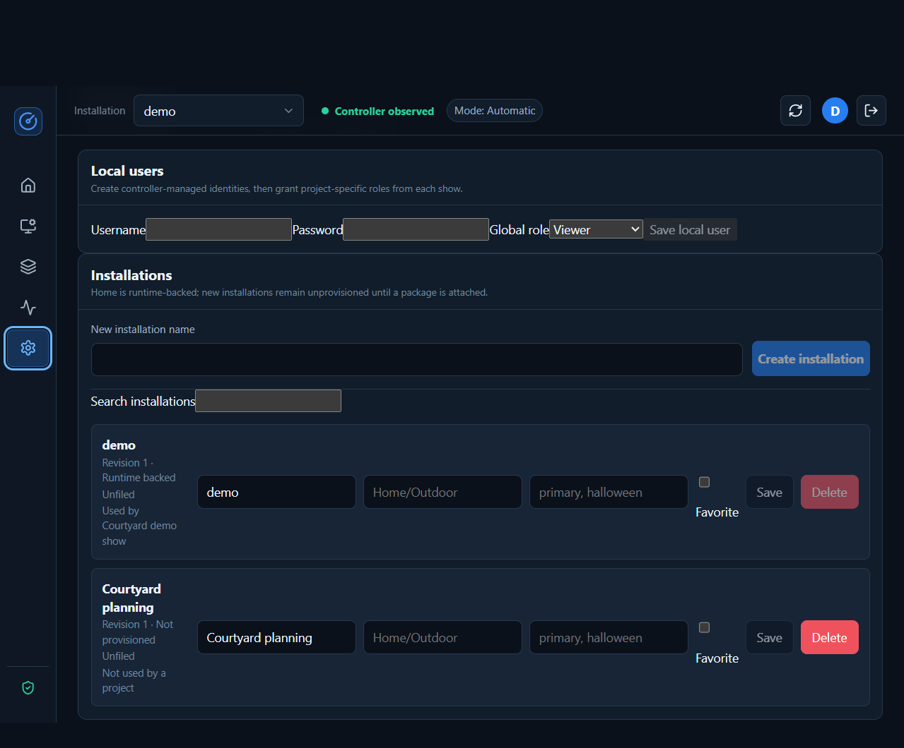

# Service administration guide

This guide is for the technical operator responsible for installing, securing,
maintaining, and recovering Cueverge. The companion
[installation and show operator guide](operator-guide.md) covers creative setup,
rehearsal, and show-day operation.

These instructions describe the current repository implementation, not every
outcome in the GUI roadmap. Cueverge is early-stage software: qualify the exact
controller, media hosts, content, and physical outputs before unattended use.

## Contents

- [Service model and requirements](#service-model-and-requirements)
- [Deploying the controller](#deploying-the-controller)
- [Enrolling and maintaining media hosts](#enrolling-and-maintaining-media-hosts)
- [Users, roles, and project access](#users-roles-and-project-access)
- [Monitoring and routine maintenance](#monitoring-and-routine-maintenance)
- [Release handover and upgrades](#release-handover-and-upgrades)
- [Backup and recovery](#backup-and-recovery)
- [Troubleshooting](#troubleshooting)

## Service model and requirements

### Components and responsibilities

| Component | Responsibility | Deployment boundary |
| --- | --- | --- |
| Controller | Scene lifecycle, autonomous direction, media-clock-following lighting, GUI API, durable authoring data, rendering and publication | Headless Python service; Docker image provided |
| Browser | Installation mapping, project editing, review, diagnostics, and authorized commands | React application served by the controller production build |
| Direct media agent | mpv playback, embedded audio, playback telemetry, verified artifact cache | Windows or Linux host with access to the actual graphical session |
| Lighting adapter | Sends configured RGB DDP frames | Controller-owned output; disabled by default |
| Observation ingress | Receives configured Frigate MQTT observations | Optional controller adapter; disabled by default |
| Device listener | Certificate-authenticated protocol-v2 WebSocket sessions | Separate mTLS listener; disabled until configured |

The controller chooses the scene; the designated media output supplies
authoritative playback time. Network connectivity is not proof that a projector,
speaker, or physical pixel is functioning.

The controller has one running scene catalog loaded from
`CUEVERGE_SHOW_PACKAGE`. Settings can store additional installation records,
but those records do not start additional controllers or provision hardware.
Use separate controller deployments when independent running installations
are required.

### Software and host requirements

| Host | Required |
| --- | --- |
| Container controller | Docker Engine and Docker Compose; persistent writable storage; connectivity to configured devices and services |
| Source controller | Python 3.12+, `uv` (the locked environment's PyAV wheel bundles the FFmpeg libraries used for asset processing and rendering), CA certificates |
| Frontend build host | Node.js and npm; the supplied Docker build uses Node 22 |
| Media host | Python 3.12+, `uv`, mpv, local media/cache storage, GPU/display/audio access, outbound connectivity to the controller |
| Operator workstation | A current browser able to run the React application; use a desktop-sized viewport for detailed mapper and timeline work |

The authoritative native executable, codec, filter, and package inventory is
[controller-native-dependencies.json](../deploy/controller-native-dependencies.json).
The container entrypoint validates it before starting. Node.js is a build
dependency, not a final controller-image requirement. mpv belongs on media
hosts, not in the headless controller container.

There is no published minimum CPU, RAM, GPU, or disk-speed specification.
Measure on the intended controller using representative assets and concurrent
render work; do not infer hardware capacity from a successful demo.
Allow storage for originals, upload staging, review derivatives, rendered
outputs, published packages, retained rollback data, and backups. Media clients
also need room for the candidate and retained artifacts, not just the active file.

See [GUI scale budgets](scale-budgets.md) for qualified data-size limits.
Examples include 250 scenes per project, 5,000 indexed assets, 10,000 timeline
items per composition, 100 connected clients, and 12 installation photos.
Alert at 80 percent of a budget and re-profile before increasing a limit.

### Network and trust boundaries

| Path | Default/example | Policy |
| --- | --- | --- |
| Browser and GUI API | Container TCP 8000; Compose publishes host TCP 7000 | HTTPS through a trusted reverse proxy outside localhost |
| Device transport | TCP 7443, `wss://controller-host:7443/api/device/v2/agent/ws` | Dedicated mTLS listener, not an ordinary browser WebSocket proxy |
| Enrollment | HTTPS controller origin | One-time pairing token, reviewed capabilities, device-generated private key |
| RGB DDP | UDP 4048 outbound by default | Private output network; configure exact destination and pixel count |
| Frigate MQTT | TCP 1883 by default; choose a TLS broker port explicitly | Optional private broker connectivity; GUI-managed write-only credentials or private operator environment |
| Home Assistant MQTT control | Same broker as Frigate MQTT | Off by default; administrator toggle. Publishes discovery/state and accepts show commands on `cueverge/<installation-id>/…`; restrict publishing with broker ACLs |
| MCP | `/mcp/` on the GUI origin | Project-scoped bearer token; explicitly granted scopes |

Only publish ports that are needed. The supplied Compose file publishes HTTP
on all host interfaces unless overridden; it is not an HTTPS edge deployment.
Do not enable DDP or observation ingress as a side effect of enabling the GUI.
The unauthenticated protocol-v1 agent and HTTP control endpoints are removed;
do not deploy old `/api/v1/...` integration examples.

## Deploying the controller

### Using the published image on a Docker host

For Caddy reaching the Docker host over its LAN address, use the standalone
[Docker host Compose file](../compose.host.yaml). It pins a published image and
takes deployment-specific addresses and storage from your private environment file.
For example, a fictional Docker host deployment could use:

```dotenv
# Documentation-only values: replace with your own host, path, and HTTPS origin.
CUEVERGE_HOST_BIND_ADDRESS=192.0.2.10
CUEVERGE_HOST_DATA_DIRECTORY=/srv/cueverge
CUEVERGE_GUI_ALLOWED_ORIGINS=https://cueverge.example.com
```

These three settings are required by the Compose template, along with the
administrator password hash described below. They map:

| Docker host endpoint / volume | Container target | Purpose |
| --- | --- | --- |
| Configured Docker host address, port `7000/tcp` | `8000/tcp` | HTTP upstream for Caddy; GUI, API, and `/mcp/` |
| Configured Docker host address, port `7443/tcp` | `7443/tcp` | Direct mTLS media-agent transport, when enabled |
| Configured Docker host data directory | `/var/lib/cueverge` | Database, originals/photos, derived artifacts, renders, packages, and device CA |

Copy the Compose file and your private `.env.controller.local` to the Docker host,
then run the commands below. Public GHCR images need no login; authenticate only
if you are using a private package, as described below.

```bash
docker compose --env-file .env.controller.local -f compose.host.yaml config --quiet
docker compose --env-file .env.controller.local -f compose.host.yaml pull
docker compose --env-file .env.controller.local -f compose.host.yaml run \
  --rm --no-deps --user 0:0 --entrypoint /bin/sh controller -ec '
    mkdir -p /var/lib/cueverge/gui
    chown cueverge:cueverge /var/lib/cueverge
    chown -R cueverge:cueverge /var/lib/cueverge/gui
  '
docker compose --env-file .env.controller.local -f compose.host.yaml up -d
docker compose --env-file .env.controller.local -f compose.host.yaml ps
```

Keep the password hash single-quoted in the environment file so its `$`
characters are literal. Do not commit or share that file. The stack requires
an administrator hash, enables secure cookies, and requires your configured HTTPS
origin. The published image and application run as
an unprivileged user. The one-time initialization command runs as root only
to prepare the mounted application directory; it uses the image's account
names rather than guessing a host UID/GID. It preserves existing files.
Back up this Docker host folder and do not delete or empty it when updating.

A bind mount hides the directories and ownership prepared inside the image;
unlike a fresh Docker-managed volume, it does not copy them into the host
folder. If the controller repeatedly logs
`GUI data root is unavailable or not writable: /var/lib/cueverge/gui`, stop
the controller first, run the initialization command above, then start it
again and inspect the logs:

```bash
docker compose --env-file .env.controller.local -f compose.host.yaml stop controller
# Run the one-time initialization command above while the controller is stopped.
docker compose --env-file .env.controller.local -f compose.host.yaml up -d controller
docker compose --env-file .env.controller.local -f compose.host.yaml logs --tail=100 controller
```

Do not run the ordinary controller as root or use world-writable permissions
as a workaround. If the Docker host rejects `chown` or access still fails, inspect
the shared folder's ACL and filesystem permissions; a read-only mount or
host-enforced ACL cannot be corrected by an application setting.

For the fictional addresses above, the corresponding Caddy configuration is:

```caddyfile
cueverge.example.com {
    reverse_proxy 192.0.2.10:7000
}
```

Caddy must be able to reach your configured Docker host address from its container.
Preserve the public request Host; Caddy does this by default for this HTTP upstream. Do not
forward port 7000 from the internet or use its LAN HTTP address as the browser
URL when secure cookies are enabled.

The 7443 mapping is reserved but enrollment and its listener remain disabled
by default. To enable devices, configure both enable flags, confirm verified
TLS termination, and supply a private CA-key password as described under
[device enrollment](#enrolling-and-maintaining-media-hosts). Devices connect
directly to your configured mTLS endpoint, for example
`wss://controller.example.com:7443/api/device/v2/agent/ws`. Replace the template's
example `CUEVERGE_DEVICE_LISTENER_IDENTITIES` and
`CUEVERGE_DEVICE_LISTENER_PUBLIC_URL` with names or IPs reachable by your agents
and covered by the listener certificate. Do not put an
ordinary TLS-terminating Caddy HTTP proxy in front of this mTLS listener.
If device operation is not needed, the 7443 port mapping can be removed.

No controller-side mpv, media-agent host directories, Docker socket, DDP
inbound port, or MQTT broker port is needed for this GUI/MCP deployment.
Private show mounts and hardware output/observation adapters remain separate
opt-in configuration.

Controller images are published automatically after the Python and application
frontend CI jobs succeed for a package-affecting push to `main`, using the same
tested commit. Site/docs-only changes skip those jobs and image publication;
mixed documentation and application changes still run the full package checks.
Pull requests and pushes to other branches do not publish images.
Manual publishing from `main` remains
available through the
[Publish controller image workflow](../.github/workflows/publish-image.yml).
It checks AMD64 startup, native dependency preflight, frontend availability,
and the MCP authentication boundary before pushing a multi-platform image for
`linux/amd64` and `linux/arm64`.

Both GitHub workflows use Node.js 24-based actions. GitHub-hosted runners
support these actions; a self-hosted runner must be version 2.327.1 or newer.
CI needs no system FFmpeg: native capability and renderer tests use the
FFmpeg libraries bundled in the locked PyAV wheel. Production container
package versions remain pinned in the native dependency inventory.
This is separate from the controller's frontend build, which uses Node.js 22
in its build stage.

The registry image is `ghcr.io/bluesk1d/cueverge:latest`. Each publication also
has a `sha-<full-git-commit>` tag, and the workflow summary records the exact
digest. Prefer a digest-pinned image for a qualified installation; `latest`
changes on the next successful automatic or manual publication.

**Public images require no GHCR login or GitHub account to pull:**

```bash
docker pull ghcr.io/bluesk1d/cueverge:latest
```

For maintainers preparing a public release, make the container package public
in its GitHub package settings as well as making the source repository public.
GHCR package visibility is managed separately from repository visibility, and
new packages default to private. See GitHub's
[package visibility documentation](https://docs.github.com/en/packages/learn-github-packages/configuring-a-packages-access-control-and-visibility).
The publishing workflow still signs in with `GITHUB_TOKEN` to push images;
this does not require users pulling a public image to authenticate.

**Private images only:** before pulling or running `docker compose pull`,
authenticate on the Docker host with a GitHub credential authorized to read the
package. A classic personal access token with `read:packages` and access to the
package is supported. See GitHub's
[Container registry authentication documentation](https://docs.github.com/en/packages/working-with-a-github-packages-registry/working-with-the-container-registry).

Use your own GitHub login for `GITHUB_USERNAME`; the registry path below is the
project's image location, not the account you must use to authenticate.

```bash
read -rp 'GitHub username: ' GITHUB_USERNAME
read -rsp 'GitHub package-read token: ' GHCR_TOKEN
printf '\n'
printf '%s' "$GHCR_TOKEN" | docker login ghcr.io --username "$GITHUB_USERNAME" --password-stdin
unset GHCR_TOKEN
```

Use a registry-image stack rather than the source-build Compose file on the
Docker host. For example, behind a same-host HTTPS reverse proxy:

```yaml
services:
  controller:
    image: ghcr.io/bluesk1d/cueverge:latest
    restart: unless-stopped
    init: true
    ports:
      - "127.0.0.1:7000:8000"
    environment:
      CUEVERGE_GUI_ENABLED: "true"
      CUEVERGE_GUI_ADMIN_USERNAME: ${CUEVERGE_GUI_ADMIN_USERNAME:-admin}
      CUEVERGE_GUI_ADMIN_PASSWORD_HASH: ${CUEVERGE_GUI_ADMIN_PASSWORD_HASH:?Set the administrator hash}
      CUEVERGE_GUI_ALLOWED_ORIGINS: ${CUEVERGE_GUI_ALLOWED_ORIGINS:?Set the public HTTPS origin}
      CUEVERGE_GUI_SECURE_COOKIES: "true"
    volumes:
      - cueverge-data:/var/lib/cueverge

volumes:
  cueverge-data:
```

Supply the private environment values described below through the container
management interface or a protected Compose environment file. If the reverse proxy is
containerized, connect it over a private Docker network instead of assuming
its loopback reaches the Docker host. The controller's container HTTP port is
8000, while this example's host port is 7000. Device listener publication,
private package mounts, DDP, and MQTT remain separate opt-in configuration.
Do not remove the persistent volume when updating the image.

### 1. Prepare private configuration

Keep addresses, output mappings, passwords, CA material, and private media out
of the repository. Start with
[controller.env.example](../examples/controller.env.example).

Generate the bootstrap administrator password hash interactively:

```bash
uv sync --locked --python 3.12
uv run cueverge-gui-hash-password
```

Store the complete returned hash in private deployment configuration. Preserve
its literal `$` characters; do not paste an unquoted hash into a shell.
For a Compose environment file, use a single-quoted value:

```dotenv
CUEVERGE_GUI_ENABLED=true
CUEVERGE_GUI_ADMIN_USERNAME=admin
CUEVERGE_GUI_ADMIN_PASSWORD_HASH='scrypt$REPLACE_WITH_THE_COMPLETE_GENERATED_HASH'
CUEVERGE_GUI_ALLOWED_ORIGINS=https://cueverge.example.test
CUEVERGE_GUI_SECURE_COOKIES=true
```

The example hash is deliberately not usable. Protect the environment file and
the account used to read it. Allowed origins must match the exact browser
scheme, hostname, and port; list multiple origins comma-separated.

### 2. Build and start

From the repository root:

```bash
docker compose --env-file /srv/cueverge/controller.env build
docker compose --env-file /srv/cueverge/controller.env up -d
docker compose --env-file /srv/cueverge/controller.env ps
curl --fail http://127.0.0.1:7000/health/live
curl --fail http://127.0.0.1:7000/health/ready
```

With GUI settings omitted, the controller starts with the synthetic demo and
no browser authoring service. The image includes the production frontend and
stores GUI data at `/var/lib/cueverge/gui`.

The supplied restart policy is `"no"`. Deliberately choose and test a production
restart policy, host startup behavior, reverse proxy, firewall, and backups.
Do not assume the container will restart after reboot.

For a same-host HTTPS reverse proxy, an illustrative private
`compose.site.yaml` is:

```yaml
services:
  controller:
    ports: !override
      - "127.0.0.1:7000:8000"
    restart: unless-stopped
    environment:
      CUEVERGE_SHOW_PACKAGE: /opt/cueverge/private-show
    volumes:
      - /srv/cueverge/show:/opt/cueverge/private-show:ro
```

`!override` requires Docker Compose 2.24.4 or newer. Start the combined
configuration with:

```bash
docker compose --env-file /srv/cueverge/controller.env \
  -f compose.yaml -f /srv/cueverge/compose.site.yaml up -d
```

Configure the proxy to serve the chosen HTTPS origin and forward to
`127.0.0.1:7000`. Set appropriate upload body limits and timeouts for the asset
sizes you permit. Verify HTTPS login and secure cookies from the operator's
actual workstation.

**Environment forwarding matters:** Compose only passes the environment keys
listed in its service configuration. Adding `CUEVERGE_SHOW_PACKAGE`, DDP,
MQTT, or device settings to an `--env-file` alone does not forward them into
this service. Add those keys explicitly to a private Compose override and add
the required mounts and port mappings. Do not enable hardware in a generic
example deployment.

Camera inputs can instead be configured under **Installation > Inputs &
connections** without forwarding broker secrets into Compose. Keep the GUI data
volume persistent and controller-owned. GUI-managed credentials require a private
POSIX directory and nonsymlink files with owner-only access; use
`CUEVERGE_INPUT_MANAGEMENT=environment` on platforms without that enforcement.
Back up the input directory together with its matching GUI database, never as a
show export. See [camera input management](operations.md#camera-input-management)
for management precedence, TLS, credential rotation and recovery. An explicit
GUI/environment management-mode change requires restart.

### 3. Verify persistence and dependencies

The named `cueverge-data` volume must remain attached across recreation.
Check container logs for native dependency/preflight failures:

```bash
docker compose --env-file /srv/cueverge/controller.env logs --tail=100 controller
```

If malware scanning is required, build the ClamAV variant:

```bash
CUEVERGE_INSTALL_CLAMAV=true \
  docker compose --env-file /srv/cueverge/controller.env build
```

Supply and regularly update definitions, then set
`CUEVERGE_CLAMAV_REQUIRED=true`. Required-scanner preflight fails closed if
the executable or definitions are missing. Without a scanner, uploaded assets
can report scan status `unavailable`; that is not a clean scan.

Default upload settings are 10,000,000,000 bytes per asset,
100,000,000,000 bytes for the asset-store quota, and 8,388,608 bytes per chunk.
The corresponding `CUEVERGE_GUI_ASSET_*` overrides are in the environment
example. These are not a quota for the entire persistent volume.

### Source deployment and local development

Build the frontend when serving a production-style source installation:

```bash
cd web
npm ci
npm run build
cd ..
```

Set `CUEVERGE_GUI_ENABLED`, administrator username/hash, allowed origins,
secure-cookie policy, a writable `CUEVERGE_GUI_DATA_ROOT`, and
`CUEVERGE_GUI_WEB_ROOT` pointing to the absolute `web/dist` directory.
Start the controller with the private environment already loaded:

```bash
uv run uvicorn cueverge.controller.app:app --host 127.0.0.1 --port 7000
```

For localhost-only development, HTTP requires
`CUEVERGE_GUI_SECURE_COOKIES=false`. Never carry that exception into a
non-localhost deployment. Alternatively, `npm run dev` in `web` provides a
Vite frontend whose `/api` proxy targets controller port 7000; allow the
frontend's exact origin, normally `http://localhost:5173`.

## Enrolling and maintaining media hosts

### Enable the controller enrollment service

After verified HTTPS termination is working, explicitly configure:

```dotenv
CUEVERGE_DEVICE_ENROLLMENT_ENABLED=true
CUEVERGE_DEVICE_ENROLLMENT_TLS_TERMINATED=true
CUEVERGE_DEVICE_CA_KEY_PASSWORD='REPLACE_WITH_A_PRIVATE_RANDOM_SECRET'
CUEVERGE_DEVICE_LISTENER_ENABLED=true
CUEVERGE_DEVICE_LISTENER_HOST=0.0.0.0
CUEVERGE_DEVICE_LISTENER_PORT=7443
CUEVERGE_DEVICE_LISTENER_IDENTITIES=cueverge.example.test
CUEVERGE_DEVICE_LISTENER_PUBLIC_URL=wss://cueverge.example.test:7443/api/device/v2/agent/ws
```

Forward these settings into the container and publish the device port only
on the intended network. DNS/IP identities become certificate SANs; the
device URL must use one of those exact identities. Do not bypass verification
to work around a hostname mismatch. Back up the CA and retain its password in
your credential-recovery system.

### Enroll a host

1. Install and test mpv on the media host in its real graphical session.
2. As administrator, open **Installation > Device Management**.
3. Select the device kind, supply capabilities actually verified on that host,
   and choose **Review capabilities**. Do not advertise unsupported codecs,
   controls, cache capacity, or timing adjustments.
4. Choose **Create one-time token** and use the GUI-generated enrollment
   command on the device before the token expires. Tokens default to five
   minutes and can be used once. Enter the token only at the hidden prompt.
5. Configure both `CUEVERGE_DEVICE_TRANSPORT_URL` and
   `CUEVERGE_DEVICE_CREDENTIAL_ROOT` in the agent environment.
6. With playback idle and the device disconnected, bind its durable identity
   to the intended logical resource under **Resource assignments**.
7. Start the agent and verify fresh topology, capabilities, and cache inventory.
   Test display placement, audio, prepare/play, seek, stop, and reconnect.

The enrollment command shape is:

```bash
uv run cueverge-device-enroll \
  --enrollment-url https://cueverge.example.test/api/device/v2/enroll \
  --display-name projector-left \
  --capabilities examples/direct-media-agent-capabilities.json \
  --credential-root /home/cueverge/.config/cueverge/device-v2
```

Review the example capability file before use. The device retains its private
key; discovery or an IP address alone never grants command authority.

Follow the platform runbooks for actual service installation:

- [Linux media agent](linux-media-agent.md): user-session systemd service,
  graphical autostart, Wayland/X11 environment, and media-host acceptance checklist.
- [Windows media agent](windows-media-agent.md): interactive desktop/task
  scheduling, fullscreen selection, audio routing, and validated hardware.

Linux transport is tested, but Linux hardware qualification remains outstanding.
Use the platform checklist to qualify your media host and display before show use.

### Connection policy, rotation, and retirement

Use continuous versus on-demand connection expectations to match operational
practice. An intentional on-demand disconnect is not evidence of readiness.
For agents in on-demand player mode (`CUEVERGE_PLAYER_MODE=on_demand`), the
**On demand** policy also lets the controller close the player after 10 idle
minutes; **Continuous** leaves a started player running.
Media hosts stay reachable and keep projectors lit only while the operating system
stays awake. Set `CUEVERGE_KEEP_AWAKE=display` (or `system`) in the agent environment
on each host. Its status appears as **Keep awake** in device details. This is a
host-side setting that the controller can't change. See the Linux and Windows
media agent guides.
Run connection tests and inspect device lifecycle state before troubleshooting
by address.

For credential rotation, stop the ordinary agent task and run:

```bash
uv run cueverge-device-rotate \
  --transport-url wss://cueverge.example.test:7443/api/device/v2/agent/ws
```

Then restart the agent and verify the replacement credential connects.
Rotation is two phase: the old identity is superseded after the replacement
is persisted and successfully reconnects. Use device lifecycle controls to
disable/revoke compromised or retired devices. Do not reuse copied private
keys on another host.

## Users, roles, and project access



*Integrated-browser capture from an isolated synthetic controller. The
additional installation is visibly unprovisioned; this is not production status.*

### Bootstrap identity and local users

The configured administrator is the bootstrap/recovery identity and cannot
be replaced through the GUI. Protect its environment-supplied hash and recovery
procedure separately from routine operator accounts.

1. Sign in as administrator and open **Settings > Local users**.
2. Enter a unique username, a password of at least 12 characters, and a global
   role; choose **Save local user**.
3. Open the intended show under **Shows**, then **Collaboration > Project
   access**.
4. Add the username with the appropriate project role. Grant **Permit live
   output** only when required, and save the member.
5. Verify access while signed in as that user. A global role does not by
   itself grant access to every project.

The current local-user panel creates/updates users but does not expose every
account lifecycle action. The authenticated administrator user API supports
the `disabled` field; do not imply there is a GUI disable button. Disabling
an account or changing its role is checked on subsequent authenticated
requests.

### Permission model

| Role/grant | Intended responsibility |
| --- | --- |
| Viewer project member | Read project content, comment, and request changes |
| Designer project member | Edit drafts, assets, timeline/logic, render, and simulate |
| Operator | Operate the controller; a non-administrator also needs a live-output membership grant |
| Publisher project member | Review release metadata, approve, publish, and stage |
| Publisher with live-output grant | Activate, deactivate, and roll back packages |
| Administrator | Global configuration, users, device enrollment, assignments, and unrestricted project administration |

Project roles and global roles are separate. For example, a publisher role is
not permission to use the live transport controls, and an operator role is
not permission to publish. Global administrators bypass project membership
checks; do not use that account as the routine way to avoid a permission error.

The current live-operation authorization checks for a live-output grant in
the user's memberships, rather than an installation-scoped grant. Restrict
operator accounts accordingly; do not treat membership as multi-installation
runtime isolation.

Browser mutations use server-side sessions and CSRF protection. Integrations
must use the supported authenticated API rather than copying an old
unauthenticated control request.

### Review links and MCP clients

Review links expose revision identity metadata only; they are not a full
anonymous show preview. GUI-created links expire after seven days.

MCP tokens are project/user bound, shown once, stored as digests, and expire
within 90 days. Start with `read` scope. Draft proposals (`draft_edit`),
direct draft saves (`direct_edit`), simulation, publication preparation,
publication/staging (`publish`), and live package activation (`activate`) have
independent scopes. The new scopes are unchecked by default and existing tokens
receive no additional permissions. Direct editing requires authoring access;
publication requires publisher access; activation additionally requires a
project live-output grant. Global administrators retain the GUI's membership
bypass. User status, current roles, grants, expiry, and revocation are enforced
on subsequent requests through a shared scope policy.

Humans validate, approve with a rationale, and merge proposals in the GUI.
Merging fails if the working revision has changed. Separately scoped direct
edits save a new revision without proposal approval. Publication tokens can
approve release metadata in chat; package validation, staging prerequisites,
and simulation-mode activation restrictions are not bypassed. MCP activation
alone deploys media artifacts, not the running controller scene catalog.
Separately authorized `apply_saved_show` loads a verified saved catalog;
`operate_loaded_show` requires explicitly opted-in `live_operation`, current
operator/admin live permission, loaded-project matching and physical confirmation.
`control_device_player` starts or stops a media host's player under the same
conditions; `get_device_players` (read) lists player state.
`update_device_agents` installs the controller's agent bundle on media hosts; it
requires the separately opted-in, administrator-only `device_update` scope,
maintenance mode with no scene playing and `confirm_restart=True`.
Neither grants device enrollment or access administration.

Global administrators can also issue installation-scoped MCP tokens under
**Settings > Integrations**. These survive switching the loaded show, and each call
is still checked against the user's current role in the selected show. List and
revoke them there; audit actions are `mcp.installation_token.*`.

Revoke compromised tokens, review `mcp.tool.call`, `mcp.draft.update`,
`mcp.revision.release.update`, `mcp.package.*`, and `mcp.proposal.*` audit entries,
and inspect affected revisions, deployments, and pending proposals.
See [MCP-assisted authoring](operations.md#mcp-assisted-authoring)
for scopes, limits, and the incident procedure.

## Monitoring and routine maintenance

| Surface | What it establishes | What it does not establish |
| --- | --- | --- |
| `/health/live` | HTTP process responds | Correct show, working media, or physical output |
| `/health/ready` | Runtime responds and reports connected-agent count | All clients connected or venue safe to open |
| Overview / Installation | Configured resources and observed connectivity | Independently detected projector/audio health |
| Operate | Active scene, mode, playback time, command/render diagnostics | A human-confirmed end-to-end experience |
| Administrator `/api/gui/v1/observability` | Bounded API/job/storage/device/browser/simulation/publication metrics | Long-term retained monitoring history |

Readiness can return success with zero connected agents. Use HTTP checks
for process supervision, and separate operational checks for show readiness.
Scrape administrator observability through an authenticated collector if
long-term metrics are needed.

Before each opening, check storage headroom, fresh device inventories,
assignments, command failures/timeouts, lighting errors, skipped render
deadlines, expected operating mode, and the exact release being used.
After content changes, review failed asset/render jobs and stale bakes.
Keep external container/service logs according to site retention policy;
stdout logs are not automatically a durable log archive.

## Release handover and upgrades

**Advanced artifact boundary:** publishing creates an immutable package; staging and
activation deploy rendered artifacts and update release records. They do
not replace the running controller's scene catalog. Deactivation changes the
publication record and is not a replacement for **Stop** or **Blackout**.

Prefer **Shows > Apply saved changes** for a saved show on the same deployed
resources. It validates/approves/publishes, verifies checksummed device media,
stops safely, replaces the actual catalog, rebuilds scene/visitor scheduling
and acknowledges the loaded generation. Playing restarts from zero; paused/
stopped remains stopped. Durable jobs support cancellation before interruption
and retained-package restore; Stop/Blackout win during handover.

Managed startup recovery loads the retained package stopped before camera
ingress. Corrupt retained state is `recovery_required`, never a successful
bootstrap fallback. Preserve the GUI database and published directory together.
Once a managed catalog is retained, changing `CUEVERGE_SHOW_PACKAGE` alone does
not override it on restart: recover/apply the intended managed version, or
perform an explicit controlled backup/state migration. Do not delete private
state to make a label appear correct.

For an external catalog or deployment-routing change, plan a technical handover:

1. Review the approved source revision, publication diagnostics, asset and
   artifact checksums, resource assignments, and rollback candidate.
2. Arrange a maintenance window; stop the show and confirm physical outputs
   are safe. Back up state and private deployment configuration.
3. Stage/activate the intended device artifacts through the release workflow.
4. Point `CUEVERGE_SHOW_PACKAGE` at the verified immutable package directory.
   GUI publications reside at
   `$CUEVERGE_GUI_DATA_ROOT/published/<project-id>/<package-digest>/`.
   Ensure that path is accessible inside the controller container and that
   all referenced media are resolvable on the intended media hosts.
5. Recreate/restart the controller with the updated setting. A Compose
   `restart` alone does not apply changed environment configuration.
6. Reconnect devices, refresh status, verify the catalog/resource identities,
   and perform a supervised physical test before resuming automatic operation.

Retain the previous image, package path, device artifacts, configuration,
and consistent backup. Managed scene rollback uses retained-version restore and leaves authoring
untouched. External-catalog rollback requires its prior package/configuration
and consistent private state as well as device artifacts. Do not edit files inside a content-addressed package.

For an application upgrade, use the same maintenance procedure: build and
qualify the candidate image separately, stop before backup, start the
candidate against the preserved state, and check readiness, login, projects,
jobs, enrollment, and device reconnection. Repository migrations run during
service creation; do not assume an older image can read an upgraded database.
Recover an older version with its matching pre-upgrade snapshot when necessary.

### Media agent updates

The controller image includes an offline media agent bundle for `linux_x86_64`,
`linux_aarch64` and `windows_amd64` hosts under `CUEVERGE_AGENT_BUNDLE_ROOT`
(`/opt/cueverge/agent-bundles`). Docker build arguments `CUEVERGE_BUILD_LABEL`
(shown to operators, for example a git revision) and `CUEVERGE_AGENT_PLATFORMS`
control them. Source deployments build bundles with
`uv run cueverge-agent-bundle-build --output DIR --build LABEL` and set
`CUEVERGE_AGENT_BUNDLE_ROOT=DIR`. Bundle faults, such as two bundles for one
platform, appear in the update panel.

Prepare each media host once with `cueverge-agent-install` (see the
[Linux](linux-media-agent.md#controller-managed-updates) and
[Windows](windows-media-agent.md#controller-managed-updates) guides). After
upgrading the controller:

1. Confirm devices reconnect. Hosts showing **Update available** run an older
   agent than this controller offers.
2. Switch to maintenance mode and stop the show.
3. In **Installation > Devices > Connect and manage devices > Agent software
   updates**, update one host and confirm it returns **Up to date**, then use
   **Update all agents**. MCP `get_agent_updates` and `update_device_agents`
   (administrator-only `device_update` scope, `confirm_restart=True`) do the same.
4. Investigate **Update failed** or **Update rolled back** before retrying. The
   launcher restores the previous version on the host automatically; its log is
   in the service journal or task output and `state.json` in the agent home.

Starts are audited as `device.agent_update.start` (GUI) or
`mcp.device.agent_update.start`, and each host's install outcome as
`device.agent_update.install`. Hosts still run from a checkout show
**Manual updates only**. The update trusts the enrolled controller: anyone who
controls the controller image can run code on prepared media hosts, so protect
image provenance as carefully as device CA keys. See
[ADR 0018](decisions/0018-update-media-agents-from-the-controller.md).

## Backup and recovery

### What to preserve

Back up the entire `/var/lib/cueverge` container volume as a consistency unit,
plus private configuration, CA-key password, package mounts, and externally
stored media. For source deployments, back up the actual configured GUI data
root instead of assuming a container path.

With the default image configuration, these paths are under
`/var/lib/cueverge/gui`:

- `gui.sqlite3` and any WAL/SHM files: projects, revisions, users, memberships,
  device identities, jobs, publication records, and audit history.
- `assets/`: upload staging, original objects, installation reference images
  (also stored under `assets/objects/`), and derived review artifacts.
- `renders/`, `compiled/`, and `published/`: generated packages and artifacts.
- `device-ca/`: installation CA and encrypted signing key, when enabled.
- `simulation-scenarios/`: saved deterministic scenario inputs.

Also preserve each media host's credential root and any manually deployed
source media according to site policy. Controller backup does not back up a
remote media disk. Encrypt credential-bearing backups, restrict access, and
keep at least one known-good copy outside the controller host.

### Consistent backup and restore procedure

Before upgrading to optional photo backgrounds (migration 41), take a consistent
backup using the procedure below. The migration transactionally rebuilds the
photo association while retaining geometry IDs, linked view coordinate spaces,
indexes and downstream calibration, and checks foreign keys before committing.
Photo removal then detaches references instead of cascading into geometry.
It cannot reconstruct geometry already deleted by an older version. Do not
downgrade an upgraded database in place; use its matching pre-upgrade backup.

1. Stop the show, confirm safe output, and stop the controller before a
   file-level backup, or use a storage snapshot with a consistency guarantee.
   Never copy only the main SQLite file while writes are in progress.
2. Record the exact image/application version, package path and digest,
   configuration version, backup time, and expected device identities.
3. To restore, preserve the failed volume, then restore into a fresh volume.
   Match ownership to the image's unprivileged `cueverge` user; do not solve
   permission failures with world-writable directories.
4. Start the same application version first. Verify readiness, login,
   revision history, original assets/photos, published checksums, CA presence,
   and audit continuity.
5. Reconnect media agents and wait for fresh inventories. Review capabilities,
   assignments, cache capacity and protected artifacts before activation.
6. Rehearse and physically verify a retained known-good release before
   opening the installation.

Test restoration periodically. If the CA is lost, provision a new CA and
re-enroll devices; project metadata cannot reconstruct their identities.
If originals survive but derived files are lost, regenerate and publish a
new package rather than inserting new bytes under an old digest.

## Troubleshooting

| Symptom | First checks and safe action |
| --- | --- |
| Container exits before HTTP starts | Native preflight output, PyAV media capabilities, scanner definitions when required, valid hash/origins, writable GUI root and frontend build |
| Login fails or mutations return 403 | Exact allowed origin, HTTPS/secure-cookie settings, account state, global role, project membership, live-output grant, CSRF/session freshness |
| New installation cannot be selected | Expected for an unprovisioned record; record creation does not attach a new runtime |
| Device will not enroll/connect | Verified HTTPS, token expiry, exact capability document, certificate SAN/URL match, both agent transport settings, listener port/firewall, device lifecycle state |
| Agent connects but no usable video/audio | Graphical session ownership, projector index, mpv decode, audio device/cabling; do not launch mpv as root to bypass session issues |
| Publication blocked | Read every diagnostic: assignments, original asset availability, completed current-revision bakes, capabilities, cache inventory and capacity |
| Active release label changes but old scene logic runs | Artifact activation does not reload the runtime catalog; perform the controlled package handover above |
| Playback freezes after disconnect | Verify clock-source connectivity and fresh telemetry; time-following freezes on clock-source loss rather than inventing progress |
| Rehearsal does not finish / service stops responding | Do not assume success or keep retrying; check process health and logs, preserve scenario/revision details, and recover under the maintenance procedure |
| Blackout not visible at a disconnected device | Software cannot guarantee delivery to unreachable hardware; follow the installation's independent physical safe-stop procedure |

For show-day recovery, use the
[operator runbook](operator-guide.md#running-a-show). For engine semantics,
see [operations and simulation](operations.md) and
[device protocol v2](protocol.md).
